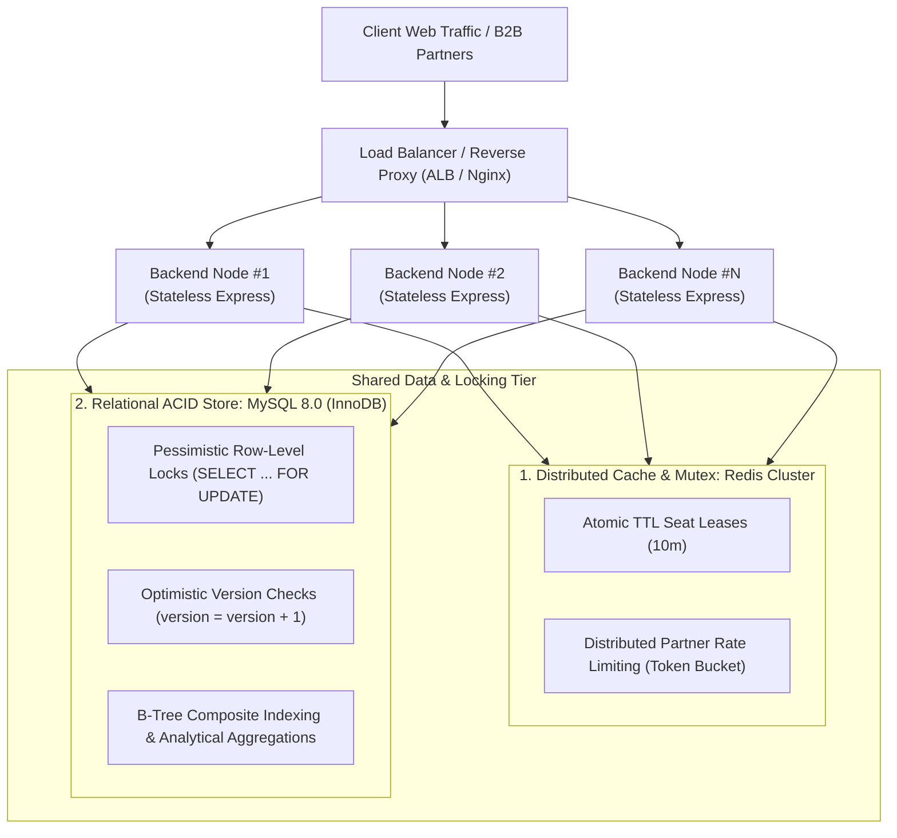
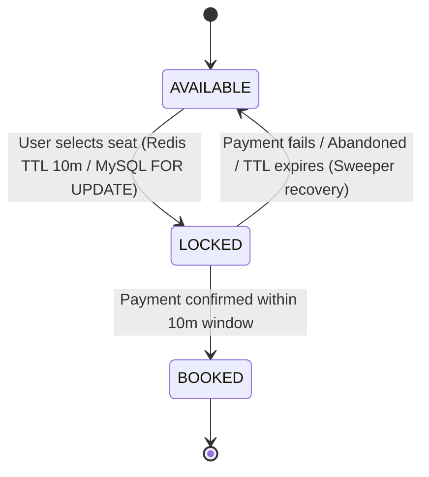

# BookMyShow Enterprise Platform

> **Production-Grade Movie Ticketing, Multi-Instance Concurrency Engine, Company Admin Control Backoffice, and Secure B2B Partner API Gateway.**

Built with **Node.js, Express, TypeScript, MySQL 8.0, Redis Distributed Mutex, and React 19 + Tailwind CSS**.

---

## 🏛️ System Architecture & Multi-Instance Topology

The platform is designed to scale across **N stateless server instances** behind an Elastic Load Balancer:



---

## ⚡ Concurrency & Race Condition Guarantees

### 1. Two-Phase Seat Reservation State Machine



1. **Phase 1: Atomic In-Memory Seat Lease (`LOCKED`)**
   - High-throughput Redis Lua script atomically claims seat keys with a **10-minute expiration timestamp**.
   - If 100 users click the exact same seat simultaneously across different backend nodes, Redis evaluates the key existence in $< 1\text{ms}$. Exactly **1 user wins the lock**; the remaining 99 callers receive immediate `409 Conflict` rejections.
   - Shields the relational database from thundering herd spikes.

2. **Phase 2: Relational ACID Settlement (`BOOKED`)**
   - The winner proceeds through payment processing.
   - Upon successful payment authorization, the order commits inside a MySQL ACID transaction utilizing:
     ```sql
     SELECT id, status, version FROM show_seats 
     WHERE id IN (?) AND status = 'LOCKED' FOR UPDATE;
     ```
   - Seat transitions to `BOOKED`, and a permanent booking confirmation with a scannable ticket is issued.

3. **Self-Healing Background Sweeper**
   - A background worker polls for seats stuck in `LOCKED` status whose expiration timestamp has passed ($> 10\text{m}$) without payment.
   - Automatically rolls back orphaned seats to `AVAILABLE` and re-seeds inventory.

---

## 🔐 B2B Partner API Gateway (HMAC-SHA256 & Rate Limiting)

Third-party cinema syndication partners (e.g. Google Pay, Paytm, Corporate Bulk Buyers) integrate via a hardened B2B Gateway:

- **Cryptographic Authentication**: Requests require an `X-Partner-Id`, `X-Timestamp`, and an `X-Signature` computed via **HMAC-SHA256(payload, secretKey)**.
- **Clock Skew & Replay Protection**: Requests with timestamps skewed $> 300\text{s}$ are rejected.
- **Distributed Token Bucket Rate Limiter**: Redis sliding token bucket throttles abusive partners (`429 Too Many Requests`).

---

## 📁 Monorepo Project Structure

```
bookmyshow/
├── backend/
│   ├── src/
│   │   ├── config/              # Environment & constants
│   │   ├── controllers/         # REST API endpoints (Browse, Booking, Admin, B2B)
│   │   ├── db/                  # MySQL schema.sql, seed.sql, connection pool
│   │   ├── middlewares/         # HMAC authentication & rate limiting
│   │   ├── services/            # SeatLockManager, BookingEngine, Sweeper
│   │   └── server.ts            # Express server entrypoint
│   ├── tests/
│   │   ├── multi_instance_concurrency.sim.ts # 100 concurrent caller test
│   │   ├── thundering_herd_1m.sim.ts        # 1M request waiting room simulation
│   │   └── b2b_gateway.test.ts              # HMAC & rate limit test
│   └── package.json
├── frontend/
│   ├── src/
│   │   ├── components/
│   │   │   ├── admin/           # Cinema hall, seat layout, showtime managers
│   │   │   ├── customer/        # Customer bookings & boarding pass
│   │   │   ├── partner/         # B2B HMAC request builder console
│   │   │   ├── SeatMatrix.tsx   # Interactive theater seat picker
│   │   │   └── CheckoutModal.tsx# Payment & checkout flow
│   │   ├── App.tsx
│   │   └── main.tsx
│   └── package.json
├── package.json
└── README.md
```

---

## 🚀 Quickstart & Verification Commands

### 1. Install Dependencies
```bash
npm install
```

### 2. Run Concurrency Simulation (100 Concurrent Callers)
```bash
npm run sim
```
*Simulates 100 concurrent workers attacking the exact same VIP seats across multiple server instances. Verifies: Exactly 1 winner, 99 conflict rejections, zero double bookings, idempotency replay, and background sweeper auto-recovery.*

### 3. Run 1,000,000 Thundering Herd & Waiting Room Simulation
```bash
npm run sim:1m
```
*Simulates extreme thundering herd contention on a single blockbuster ticket: Verifies Virtual Waiting Room FIFO queue ranking, Atomic Redis Lua script pre-locking (<1ms fast-fail in memory), 100% database connection pool shielding, and zero double bookings.*

### 4. Run B2B Partner API Gateway Security Tests
```bash
npm run sim:b2b
```
*Verifies HMAC SHA-256 signatures, tampered payload rejection (401), replay attack prevention, and Token Bucket rate limiter (429).*

### 5. Build Full-Stack Project
```bash
npm run build
```

### 6. Start Development Servers
```bash
# Terminal 1: Backend API Gateway (Port 5000)
npm run dev:backend

# Terminal 2: Frontend Client (Port 3000)
npm run dev:frontend
```
